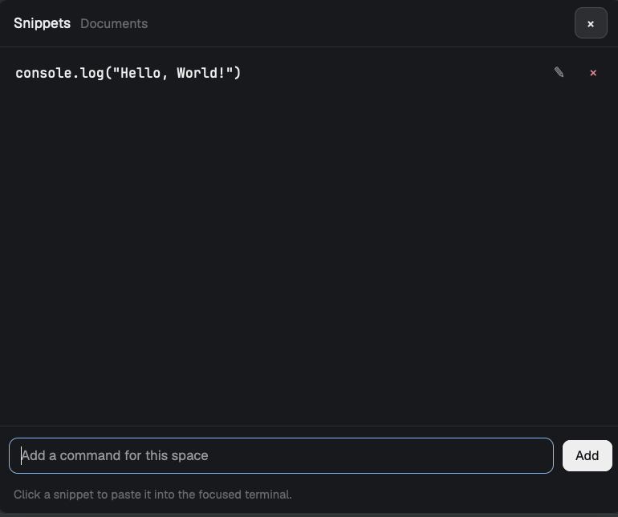

# herdr-desk

One small mod for the [Herdr](https://herdr.dev) desktop app, plus the top-bar
button that opens it:

- **Snippets**: the commands you keep retyping, pinned per space. Click one and
  it is pasted into the terminal that had the keyboard, then the shelf closes.



## Install

Ask your Herdr agent: *"install the mod from github.com/ssk090/herdr-desk"*,
or copy it by hand:

```sh
git clone https://github.com/ssk090/herdr-desk
cp -R herdr-desk/mods/snippets herdr-desk/mods/desk-bar ~/.config/herdr-app/mods/
herdr-app check ~/.config/herdr-app/mods/snippets
herdr-app check ~/.config/herdr-app/mods/desk-bar
```

### The top-bar button

Add one block to the `top-bar` row of your layout, before the other buttons:

```json
{
  "id": "desk-bar",
  "type": "block",
  "content": { "mod": "desk-bar" },
  "size": { "px": 38 }
}
```

That is one 28px button with a bolt. If you would rather not touch the top bar,
bind a key instead:

```json
"cmd-alt-s": "mod.open:snippets"
```

## Snippets

- Opened from the bolt, `mod.open:snippets`, or as a pane
  (`pane.split {mod: "snippets"}`).
- Type a command in the field at the bottom and press Enter or Add. **✎** loads
  a snippet back into the field to edit it, **×** deletes it.
- Clicking a snippet writes it to the clipboard, focuses the terminal that was
  in front when the shelf opened, and sends Ctrl+V. It does not press Enter, so
  you can edit the command first.
- Snippets are per space, stored in Herdr's shared state (`shared.json`) keyed
  by space id. They follow across layouts and restarts, but they are not in any
  repository.

## Layout

```
mods/snippets/    the shelf
mods/desk-bar/    the top-bar button
```

## License

MIT
