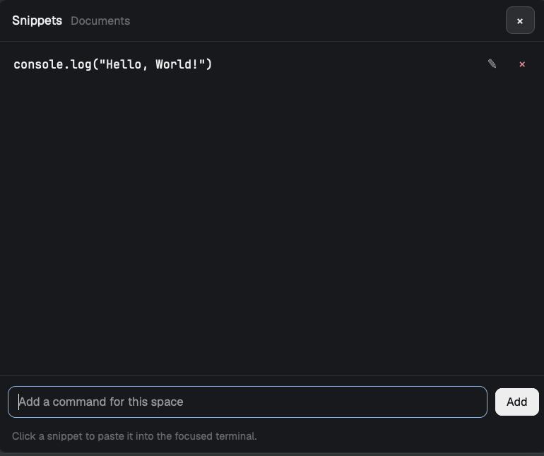

# Snippets

A shelf of the commands you keep retyping, pinned per space. A bolt in the top
bar opens it over the window; type a command, press Enter, and it is saved for
the space you are in. Click a row and the command is pasted into the terminal
that was in front, with no Enter, so you can edit it before running it.



## What you see

One window, 560 x 460, radius 10 on `background`, a 1px `border`, base type
12.5px. Top to bottom:

- **Header**, 42px, 14px side padding, 8px gap, bottom border. "Snippets" at
  12.5px semibold, then the shown space's name at 11.5px `dim`, cut with `…`.
  On the right, 28px buttons, radius 7, 11px side padding, `raised` with an
  `input` border: `Cancel` only while editing, and `×` to close the window.
- **List**, scrolling, 6px padding. One row per snippet, 34px, 10px side
  padding, radius 7, `hover` under the pointer. The command is 12px, monospace
  (the terminal's font family), `foreground`, cut with `…` when long. On the
  right, two 22px glyph buttons at 12px: `✎` in `muted`, `×` in `ansi1`.
- **Footer**, top border. A 32px field, radius 8, 10px side padding, 12px
  monospace, on `background`, with an `input` border that turns `accent` while
  focused and the placeholder `Add a command for this space`. Beside it a 28px
  `Add` button on `solid` (it reads `Save` while editing). Under both, an 10.5px
  line in `dim`: the hint `Click a snippet to paste it into the focused
  terminal.` when there are rows, `Add the commands you retype. Enter saves.`
  when there are none, `New` or `Editing` on the right while in that mode, or a
  problem in `ansi1` (`Type a command first.`, `Cannot save: …`).

In a top bar it is not this window: with `props: { "bar": true }` the mod draws
only a 28px square with a 17px bolt in `dim`, on `hover` under the pointer.

## How it behaves

- **Opening.** The bolt calls `openOverlay({ mod: "snippets", kind: "window",
  key: "snippets", width: 560, height: 460 })`. A key can call
  `mod.open:snippets`, which uses the same size from `mod.json`. It opens on the
  space that is shown, and stays on that space while open. The field takes the
  keyboard on open, so you can type at once.
- **Adding.** Type and press Enter or click Add. The text is trimmed; empty text
  shows a problem instead of saving. The new snippet goes to the top of the
  shown space's list and a toast says `Snippet added`.
- **Editing.** `✎` puts that row's text in the field, selected, turns the button
  into `Save` and shows `Cancel`. Save replaces the row in place.
- **Deleting.** `×` removes the row at once. No confirmation, no undo.
- **Pasting.** Clicking a row writes the command to the clipboard, focuses the
  terminal that was in front (the last one seen while this space was shown),
  closes the window, then runs `terminal.paste`. It never presses Enter.
- **Per space.** Snippets belong to the shown space, keyed by its id; the same
  shelf in another space is empty until you add to it. They survive restarts.
- **Nothing else.** No search, no reordering, no folders, no sync. The window
  stays where it was last dragged; `key: "snippets"` reopens it there.
  `Escape` is not handled (a window sends it to the mod), so use `×`.

## Built from

One mod, `mods/snippets/`:

- `main.js`: the view. One class, `props.bar` picks the top-bar button, anything
  else is the shelf. The field is an `InputState` made in `init`; it is always
  mounted, so add does not depend on focus timing.
- `mod.json`: `{ "place": "none", "title": "Snippets", "overlay": { "kind":
  "window", "width": 560, "height": 460, "key": "snippets" } }`.
- `bolt.svg`: a 24 x 24 Lucide `zap`, `currentColor` stroke, width 2.

State is Herdr's shared state under the key `snippets`:

```json
{ "sp105372abbd598e2327cb4db0c89c9844": [ { "t": "git status", "at": 1793615393798 } ] }
```

Space ids are `spaces()[i].id`; `t` is the command and `at` a timestamp (kept,
not shown). Every change replaces the whole map with `setShared`.

`herdr` functions used: `props`, `spaces`, `focused`, `shared`, `setShared`,
`theme`, `settings` (for the terminal font), `notify`, `run`, `openOverlay`,
`closeOverlay`. Clipboard writes go through `cx.write_to_clipboard`. Commands:
`pane.focus {pane | terminal}` and `terminal.paste`. The mod does not use
`exec`, `hc`, the network, or any file outside its own folder.

The top-bar block is the person's own layout, not shipped here:

```json
{
  "id": "snippets",
  "type": "block",
  "content": { "mod": "snippets", "props": { "bar": true } },
  "size": { "px": 38 }
}
```

## Watch out

- **Do not use a popup.** A popup sizes to its content, so the shelf collapsed
  to about 120px and the add field fell below the cut: it looked like add did
  nothing. Use `window` (fixed size, draggable) or `dialog`, or give the content
  real height.
- **Save reads `input.value()`, not a copy kept by the `change` event.** A
  programmatic `set_value` does not fire `change`, and fast input can slip past
  a cached draft.
- **The field must exist before it is focused.** It is always rendered; only
  then can `input.focus()` from the click or from `init` land.
- **Without `props.bar` in the layout block the top bar draws the whole shelf.**
  And `openOverlay` adds `props.overlay`, so the overlay never sees `bar`.
- The paste target is captured at render from `focused()`. Clicking a row after
  changing terminals elsewhere still pastes into the captured terminal, by
  design. If no terminal was ever seen, it pastes into whatever has focus.
- `shared.json` is the only store. Removing the mod does not remove snippets;
  editing that file by hand while the app runs can be overwritten.
- Plain `ctrl` keys belong to terminal programs. The suggested key is
  `cmd-alt-s`.

## Done when

- `herdr-app check ~/.config/herdr-app/mods/snippets` passes.
- A top-bar block with `props: { "bar": true }` shows a bolt; clicking it opens
  a 560 x 460 shelf titled with the space name.
- Typing `git status` and pressing Enter adds a row and shows the toast;
  reopening the shelf still lists it.
- Clicking the row pastes `git status` into the terminal behind, with no Enter,
  and the shelf closes.
- Switching to another space shows an empty shelf, and switching back shows the
  row again.
- `✎` loads the text, Save replaces it; `×` removes it; empty Add shows the red
  `Type a command first.`
